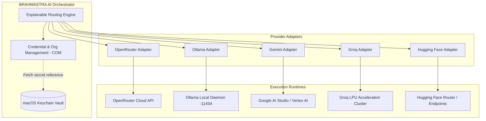
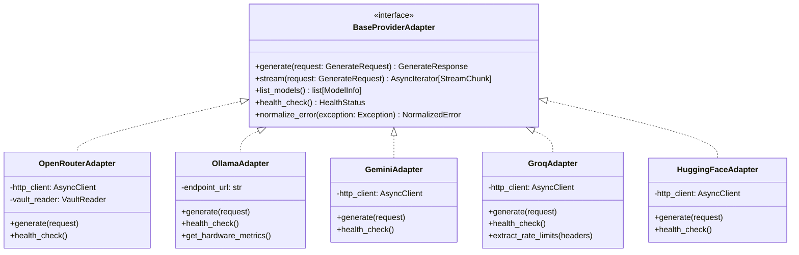
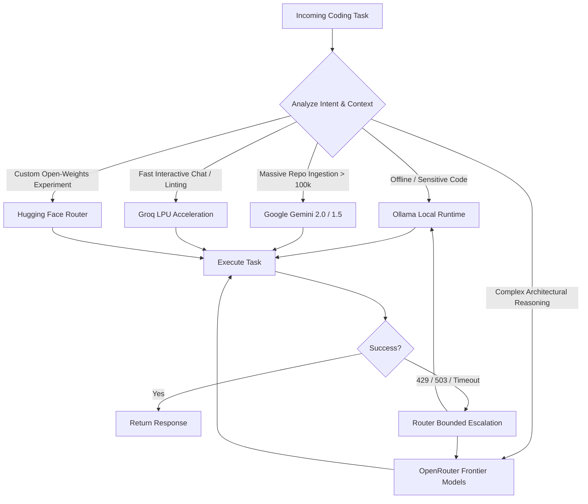

# Provider Architecture Comparison: OpenRouter, Ollama, Google Gemini, Groq, and Hugging Face

**Author:** BRAHMASTRA AI Research & Architecture  
**Target Component:** `src/brahmastra/domain/providers/`, `src/brahmastra/infrastructure/providers/`, and Routing Engine  
**Document Classification:** Technical Architecture & Orchestration Research  

---

## 1. Executive Summary & Orchestration Matrix

BRAHMASTRA is designed as a provider-independent AI orchestration platform and developer-first CLI coding assistant. A core tenet of BRAHMASTRA is the **Modular Monolith** architecture: business logic, domain entities, and routing policies remain strictly decoupled from third-party vendor SDKs, wire protocols, and transient cloud pricing models.

To establish multi-provider resilience and cost-efficient intelligent routing, BRAHMASTRA evaluates five premier inference execution engines:
1. **OpenRouter:** Cloud aggregator providing unified access to 300+ models with automated fallback routing and budget enforcement.
2. **Ollama:** Local, air-gapped open-weights runtime executing on developer hardware (optimized for Apple Silicon unified memory).
3. **Google Gemini:** Hyperscaler frontier model platform offering massive context windows (up to 2M tokens) and native multimodal capabilities.
4. **Groq:** Custom Language Processing Unit (LPU) silicon inference engine delivering near-instantaneous token generation speeds (250–1000+ T/s).
5. **Hugging Face:** Open-source model hub offering serverless inference, the new multi-provider OpenAI-compatible inference router, and dedicated container endpoints.

### Executive Orchestration Comparison Matrix

| Evaluation Dimension | OpenRouter | Ollama (Local) | Google Gemini | Groq | Hugging Face (Inference Router) |
| :--- | :--- | :--- | :--- | :--- | :--- |
| **Primary Deployment** | Cloud Multi-Model Gateway | Local Edge / On-Device (macOS) | Cloud Hyperscaler (AI Studio / Vertex) | Cloud High-Speed LPU | Cloud Serverless / Router / Dedicated |
| **Wire Protocol** | OpenAI REST (`/chat/completions`) | Native REST (`/api/chat`) + OpenAI (`/v1`) | Google REST + OpenAI (`/v1beta/openai`) | OpenAI REST (`/openai/v1`) | OpenAI REST (`/v1`) + Native HF Hub |
| **Auth Mechanism** | Bearer Token (`sk-or-v1-...`) | None (default loopback) / Bearer token | API Key (`AIzaSy...`) or OAuth2 / ADC | Bearer Token (`gsk_...`) | User Access Token (`hf_...`) |
| **Max Context Window** | Up to 2,000,000 tokens (Gemini backends) | Hardware bound (Default 2k, up to 128k) | 1,000,000 – 2,000,000 tokens | Up to 128,000 tokens (Llama 3.3) | Model bound (Typically 4k – 32k) |
| **Streaming (SSE)** | Native SSE (`stream: true`) | Native NDJSON or SSE | Native SSE / Chunked Transfer | Native SSE (Ultra-low TTFT) | Native SSE (`stream: true`) |
| **Tool / Function Calling** | Full (Model-dependent, OpenAI schema) | Native tools (Modern models: Llama, Qwen) | Full (Function Declarations & OpenAI) | Full (Strict OpenAI Tool Calling) | Inconsistent across serverless backends |
| **Structured Output (JSON)** | Supported (`json_object` & JSON schema) | Strict Grammar Engine (`format: schema`) | Native Schema (`response_schema`) | Strict JSON Mode & JSON Schema | Backend dependent (TGI outlines) |
| **Latency & Speed** | Moderate (+30-80ms gateway overhead) | Hardware-bound (~25–70 T/s on M-series) | Fast (~150–250 T/s on Flash 2.0) | Ultra-Fast (~250–1000+ T/s) | Variable (Cold starts on serverless) |
| **Quota & Rate Telemetry** | Rich (`GET /api/v1/key`, headers) | Local resource telemetry (stats in body) | `429` payload + GCP quotas | Real-time headers (`x-ratelimit-*`) | Rate headers on Router; 503 on warmup |
| **Pricing Model** | Pay-as-you-go + Free models (`:free`) | 100% Free (Electricity & compute only) | Generous Free Tier + Competitive Paid | Generous Free Tier + Low-cost Paid | Free Serverless / $9 Pro / Paid Endpoints |
| **BRAHMASTRA Role** | Primary Universal Fallback & Frontier Proxy | Local Development, Offline & Zero-Cost Privacy | Long-Context Repository Ingestion & Reasoning | High-Frequency Agent Iteration & Fast Search | Open-source Model Experimentation & Niche Tasks |

---

## 2. Deep Dive Provider Profiles



---

### Provider 1: OpenRouter

#### API Design & Standard Protocols
* **Endpoint Architecture:** Strictly mirrors the OpenAI Chat Completions specification (`POST https://openrouter.ai/api/v1/chat/completions`). Additional metadata endpoints include `GET /api/v1/models` (catalog listing with live context lengths and pricing), `GET /api/v1/key` (credential budget and rate limits), and `GET /api/v1/generation` (post-hoc generation telemetry).
* **Protocol Extensions:** OpenRouter accepts supplemental attribution and routing headers:
  * `HTTP-Referer`: Identifies client application origin (e.g. `https://github.com/brahmastra-ai`).
  * `X-Title`: Clean display title for usage analytics (`BRAHMASTRA CLI`).
  * Extended body parameters: `models: ["anthropic/claude-3.5-sonnet", "openai/gpt-4o"]` (enables automated provider failover directly within the cloud proxy), `provider: { order: ["Anthropic", "Together"], allow_fallbacks: false }`.
* **SDK Compatibility:** Standard `openai` Python SDK functions seamlessly by setting `base_url="https://openrouter.ai/api/v1"`. No custom binary C-extensions required.

#### Authentication & Credential Format
* **Mechanism:** HTTP Authorization Bearer token header (`Authorization: Bearer <token>`).
* **Format:** Prefixed string: `sk-or-v1-[a-f0-9]{64}`.
* **Credential Verification:** Instantaneous, non-billed verification can be performed against `GET https://openrouter.ai/api/v1/key`.
* **Security & Vault Alignment:** Fully compatible with macOS Keychain storage using the reference pattern `brahmastra:org-{id}:account-openrouter-{name}`. Provisioning keys allow setting hard spend caps directly on the token.

#### Model Catalog & Capabilities
* **Breadth:** Aggregates 300+ frontier and open models (Anthropic Claude 3.5 Sonnet, OpenAI GPT-4o, DeepSeek-V3/R1, Meta Llama 3.3 70B, Qwen 2.5 Coder, Google Gemini 2.0/1.5).
* **Context Windows:** Range from 8K up to 2,000,000 tokens depending on the underlying model.
* **Streaming:** Full Server-Sent Events (SSE) support streaming token deltas and token usage chunks.
* **Tool / Function Calling:** Passed through transparently using the OpenAI schema (`tools`, `tool_choice`). Tool reliability depends on the destination model.
* **Structured Output:** Supports standard JSON mode (`response_format: {"type": "json_object"}`) and JSON schema constrained generation where supported by the underlying provider.

#### Rate Limits, Latency & Quota Tracking
* **Telemetry via API:** `GET /api/v1/key` returns real-time budget metadata:
  ```json
  {
    "data": {
      "label": "brahmastra-dev",
      "usage": 1.42,
      "limit": 10.00,
      "is_free_tier": false,
      "rate_limit": { "requests": 200, "interval": "10s" }
    }
  }
  ```
* **Free Tier Policies:** Models designated with `:free` (e.g., `meta-llama/llama-3.3-70b-instruct:free`). Free tier is globally capped at 20 Requests Per Minute (RPM); daily limits are 50 Requests Per Day (RPD) for accounts with < $10 lifetime credit, and 1,000 RPD for accounts with >= $10 lifetime purchase.
* **Latency Profile:** Incurs a minor proxy overhead of 30–80ms TTFT (Time to First Token) compared to direct API calls.

#### Pros & Cons for BRAHMASTRA
* **Pros:** Single integration unlocks every major commercial and open-source model; built-in server-side model fallbacks; granular spend caps per key; rich key validation endpoint.
* **Cons:** Network hop adds latency; upstream provider outages cause ambiguous error codes; token markup on select non-standard providers.

---

### Provider 2: Ollama (Local Runtime)

#### API Design & Standard Protocols
* **Endpoint Architecture:** Local HTTP daemon running at `http://localhost:11434` (configurable via `OLLAMA_HOST`).
  * Native endpoints: `POST /api/chat`, `POST /api/generate`, `GET /api/tags` (list downloaded models), `POST /api/show` (inspect model architecture/template), `POST /api/pull`, `GET /api/ps` (inspect active models loaded in VRAM).
  * Compatibility endpoint: `POST /v1/chat/completions` and `GET /v1/models` (OpenAI drop-in compatibility).
* **SDK Compatibility:** Official `ollama-python` library provides native typing and async support; raw `httpx` async calls ensure zero external dependencies; also interoperable with standard `openai` Python SDK.

#### Authentication & Credential Format
* **Mechanism:** None by default (local loopback interface).
* **Remote Access:** When deployed on a LAN/remote workstation, Ollama can be fronted by an authenticating reverse proxy (Nginx/Caddy) using HTTP Basic Auth or Bearer tokens.
* **BRAHMASTRA Credential Representation:** In BRAHMASTRA's Credential and Organization Management (COM) layer, an Ollama credential represents an endpoint locator:
  * `endpoint_url`: `http://localhost:11434`
  * `auth_token`: Optional string (empty for local, Bearer token for secure remote servers).
  * Vault storage: Since local endpoints lack sensitive secrets, the vault reference can store an empty string or token pointer, preventing credential leak vectors.

#### Model Catalog & Capabilities
* **Catalog:** Any GGUF-quantized model from Ollama Library or Hugging Face (Llama 3.3, Qwen 2.5 Coder, DeepSeek-R1 distillations, Mistral, Gemma 2, Phi-4).
* **Context Windows:** Configurable per request or Modelfile via parameter `num_ctx` (default is 2,048; can be expanded to 32,768, 65,536, or 131,072 depending on unified RAM capacity).
* **Streaming:** Real-time streaming via NDJSON on `/api/chat` or SSE on `/v1/chat/completions`.
* **Tool / Function Calling:** Modern models (Llama 3.1/3.3, Qwen 2.5, Mistral) support function calling natively via the `tools` parameter in `/api/chat` or `/v1/chat/completions`.
* **Structured Output:** Industry-leading grammar-based sampling. Supplying `format: <json_schema>` forces the llama.cpp grammar engine to emit only byte sequences that strictly satisfy the JSON schema without hallucinations.

#### Rate Limits, Latency & Quota Tracking
* **Limits:** No artificial rate limits or quotas. Constrained entirely by host compute (Apple Silicon GPU cores, Memory Bandwidth, Thermal Limits).
* **Telemetry:** Every completion returns comprehensive hardware and execution metrics:
  * `total_duration`, `load_duration`, `prompt_eval_count`, `prompt_eval_duration`, `eval_count`, `eval_duration`.
  * Allows BRAHMASTRA to compute exact local tokens-per-second (`eval_count / (eval_duration / 1e9)`).
* **Latency Profile:** Zero network latency. On Apple Silicon (M1/M2/M3/M4 Max/Pro), token generation ranges from 25 to 80 T/s for 7B–14B models and 15–30 T/s for 70B models (quantized Q4_K_M).

#### Pros & Cons for BRAHMASTRA
* **Pros:** Complete data privacy (code never leaves developer machine); 100% offline capability; zero inference cost; grammar-constrained JSON schemas guarantees valid outputs; deep macOS Apple Silicon optimization.
* **Cons:** High RAM and GPU memory consumption; large context windows (>32k) drastically reduce generation speed on modest hardware; background model loading introduces cold-start latency when swapping models in VRAM.

---

### Provider 3: Google Gemini

#### API Design & Standard Protocols
* **Endpoint Architecture:**
  * **Google AI Studio (Developer API):** `POST https://generativelanguage.googleapis.com/v1beta/models/{model}:generateContent` (and `streamGenerateContent`).
  * **OpenAI-Compatible Gateway:** `POST https://generativelanguage.googleapis.com/v1beta/openai/chat/completions` (allows direct use of OpenAI SDK).
  * **Vertex AI (Enterprise):** `https://aiplatform.googleapis.com/v1/projects/{project}/locations/{location}/endpoints/...`.
* **SDK Compatibility:** The modern `google-genai` Python SDK provides full native async, structured typing, and streaming support (superseding legacy `google-generativeai`).

#### Authentication & Credential Format
* **Mechanism:**
  * AI Studio: API Key passed via header `x-goog-api-key: <key>` or query string `?key=<key>` (OpenAI-compatible endpoint accepts standard `Authorization: Bearer <key>`).
  * Vertex AI: Google Cloud IAM OAuth2 tokens / Application Default Credentials (ADC) via service accounts.
* **Format:** AI Studio key begins with prefix `AIzaSy` (39 characters).
* **Security & Vault Alignment:** Securely stored in macOS Keychain under reference `brahmastra:org-{id}:account-gemini-{name}`.

#### Model Catalog & Capabilities
* **Catalog:** Gemini 2.0 Flash, Gemini 2.0 Flash-Lite, Gemini 1.5 Pro, Gemini 1.5 Flash, Gemini 1.5 Flash-8B.
* **Context Windows:** Industry pinnacle. 1,000,000 to 2,000,000 tokens across Gemini 1.5 Pro and 2.0 Flash. Ideal for ingesting entire codebases into active context.
* **Streaming:** High-performance chunked transfer and SSE streaming.
* **Tool / Function Calling:** Robust support via `function_declarations` in native API, or standard OpenAI `tools` schema via the OpenAI endpoint.
* **Structured Output:** Native schema enforcement via `generationConfig.response_mime_type = "application/json"` and `generationConfig.response_schema`.

#### Rate Limits, Latency & Quota Tracking
* **Free Tier Policies (AI Studio):**
  * Gemini 2.0 Flash Free Tier: 15 RPM, 1,000,000 TPM, 1,500 RPD.
  * *Crucial Privacy Caveat:* Prompts and responses on the free tier are logged and reviewed by human reviewers for Google model training.
* **Paid Tier:** 1,000–4,000 RPM depending on tier; strict data privacy (data is NOT used to train Google models).
* **Quota Errors:** Throws HTTP `429 RESOURCE_EXHAUSTED` with detailed quota breakdown in the error JSON body.
* **Latency Profile:** Gemini 2.0 Flash achieves industry-leading speed for a frontier model (~150–250 T/s) with time-to-first-token under 250ms.

#### Pros & Cons for BRAHMASTRA
* **Pros:** 2M context window permits zero-chunking codebase ingestion; highly performant multimodal capabilities (reading UI mockups and terminal screenshots); very competitive pricing ($0.10 / $0.40 per 1M tokens on Flash 2.0).
* **Cons:** Free tier logs data for model training (requires strict warning in BRAHMASTRA COM layer); OpenAI compatibility layer occasionally lags behind native features (e.g. system instructions nuances).

---

### Provider 4: Groq

#### API Design & Standard Protocols
* **Endpoint Architecture:** Native OpenAI compatibility layer (`POST https://api.groq.com/openai/v1/chat/completions`). Additional endpoints include `GET https://api.groq.com/openai/v1/models`.
* **Hardware Architecture:** Executes entirely on custom Tensor Streaming Processor (TSP) LPU silicon architectures, eliminating memory bandwidth bottlenecks typical of traditional GPUs.
* **SDK Compatibility:** Official `groq` Python SDK (thin, high-performance wrapper around `httpx`), or standard `openai` SDK with `base_url="https://api.groq.com/openai/v1"`.

#### Authentication & Credential Format
* **Mechanism:** HTTP Authorization Bearer token header (`Authorization: Bearer <token>`).
* **Format:** Prefixed string: `gsk_[a-zA-Z0-9]{48}`.
* **Credential Verification:** Verified via `GET https://api.groq.com/openai/v1/models`.
* **Security & Vault Alignment:** Stored in macOS Keychain under reference `brahmastra:org-{id}:account-groq-{name}`.

#### Model Catalog & Capabilities
* **Catalog:** High-throughput open-weights models: Llama 3.3 70B Versatile, Llama 3.1 8B Instant, DeepSeek-R1-Distill-Llama-70B, Qwen 2.5 Coder 32B, Mixtral 8x7B.
* **Context Windows:** Up to 128,000 tokens for Llama 3.3/3.1; 8,192 to 32,768 for distilled/specialized models.
* **Streaming:** Standard SSE, producing output tokens faster than human reading capability.
* **Tool / Function Calling:** First-class OpenAI tool calling format (`tools` and `tool_choice`).
* **Structured Output:** Supports `response_format: { type: "json_object" }` as well as constrained schema outputs.

#### Rate Limits, Latency & Quota Tracking
* **Real-time Quota Telemetry Headers:** Groq exposes rate limit metadata on **every** response:
  * `x-ratelimit-limit-requests`: Maximum RPD.
  * `x-ratelimit-remaining-requests`: Remaining RPD.
  * `x-ratelimit-reset-requests`: Reset timer (e.g. `2m59s`).
  * `x-ratelimit-limit-tokens`: Maximum TPM.
  * `x-ratelimit-remaining-tokens`: Remaining TPM.
  * `retry-after`: Seconds to pause (present on HTTP `429`).
* **Free Tier Limits:** Highly generous for development (e.g., Llama 3.3 70B: 30 RPM, 6,000–30,000 TPM, 14,400 RPD).
* **Latency Profile:** World record speeds: 250 to 1,000+ tokens per second. TTFT typically under 120ms.

#### Pros & Cons for BRAHMASTRA
* **Pros:** Unmatched execution speed; instant feedback loops for multi-turn agent refactoring and tool execution; comprehensive rate limit telemetry in response headers enables precise proactive router throttling.
* **Cons:** TPM limits on the free tier can be exhausted quickly by large prompts; model selection is restricted to open-weight architectures supported by LPU compiler passes; context window is capped at 128k.

---

### Provider 5: Hugging Face

#### API Design & Standard Protocols
* **Endpoint Architecture:**
  * **Inference Router (New 2025/2026 standard):** `POST https://router.huggingface.co/v1/chat/completions`. OpenAI-compatible gateway directing requests to premier serverless backends (Together, Groq, DeepInfra, Sambanova, Novita).
  * **Serverless Inference API (Legacy/Direct):** `POST https://api-inference.huggingface.co/models/{model_id}`.
  * **Dedicated Inference Endpoints:** Private containerized deployments (TGI/vLLM) hosted on AWS/GCP/Azure infrastructure under customer control (`https://{custom-id}.us-east-1.aws.endpoints.huggingface.cloud`).
* **Model Naming on Router:** Requires provider qualification or automatic routing (e.g., `model="meta-llama/Llama-3.3-70B-Instruct:groq"` or `deepseek-ai/DeepSeek-R1:together`).
* **SDK Compatibility:** `huggingface_hub` Python library (`InferenceClient`), or standard `openai` SDK pointing to `https://router.huggingface.co/v1`.

#### Authentication & Credential Format
* **Mechanism:** HTTP Authorization Bearer token header (`Authorization: Bearer <token>`).
* **Format:** User Access Token (Fine-grained or Read token), prefixed with `hf_...` (37 characters).
* **Security & Vault Alignment:** Stored in macOS Keychain under reference `brahmastra:org-{id}:account-hf-{name}`.

#### Model Catalog & Capabilities
* **Catalog:** Tens of thousands of community and foundation models.
* **Context Windows:** Varies widely by model and hosting backend (typically 4K–32K on serverless, up to 128K on dedicated endpoints).
* **Streaming:** Supported via SSE across both Router and Serverless Inference API.
* **Tool / Function Calling:** Variable. Well-supported on Router when mapped to leading backends; inconsistent on legacy serverless endpoints.
* **Structured Output:** Available on Router and Dedicated Endpoints running Text Generation Inference (TGI) with Outlines integration.

#### Rate Limits, Latency & Quota Tracking
* **Serverless Tiers:**
  * Free Tier: Rate limited dynamically by IP and account tier; subject to cold starts (`503 Service Unavailable` with `estimated_time` payload when spinning up cold models).
  * HF PRO Subscription ($9/mo): Multiplies rate limits on serverless endpoints.
  * Dedicated Endpoints: Billed per GPU-hour ($0.60/hr to $4.50+/hr); zero rate limits aside from provisioned concurrency.
* **Latency Profile:** Serverless can exhibit high variability (100ms to 30s during cold starts); Router endpoints match upstream backend speeds.

#### Pros & Cons for BRAHMASTRA
* **Pros:** Unrivaled access to open weights, fine-tunes, and community checkpoints; flexible deployment models (serverless to private dedicated cloud); Router simplifies multi-provider open-weights execution.
* **Cons:** Legacy serverless cold-starts cause intermittent timeouts; model capabilities (tool use, JSON schema) vary widely; gated models (e.g. Llama official weights) require out-of-band license acceptance on the Hugging Face website.

---

## 3. Cross-Provider Comparative Analysis

### 3.1 Protocol & Wire Compatibility

Every provider under consideration now provides an OpenAI Chat Completions compatible interface. However, subtle protocol divergence exists:

```text
[OpenAI Standard Format]
POST /chat/completions
{
  "model": "string",
  "messages": [{"role": "user"|"assistant"|"system"|"tool", "content": "..."}],
  "tools": [{"type": "function", "function": {...}}],
  "response_format": {"type": "json_object" | "json_schema"}
}
```

* **OpenRouter:** 100% wire-compatible. Enriches request with fallbacks and routing params.
* **Groq:** 100% wire-compatible. Strictly enforces parameter schemas.
* **Google Gemini:** OpenAI endpoint handles messages and tools cleanly. However, developer features such as Google Search grounding and file upload tokens require the native Gemini protocol (`generateContent`).
* **Ollama:** OpenAI endpoint (`/v1`) handles standard chat. However, hardware statistics (`eval_count`, `eval_duration`) and advanced grammar tuning (`repeat_penalty`, `top_k`) are exclusive to the native `/api/chat` route.
* **Hugging Face:** Router endpoint (`/v1`) adheres to OpenAI specs, but requires model strings to be formatted as `org/model:provider`.

### 3.2 Tool Calling & Structured Output Robustness

For a coding agent CLI like BRAHMASTRA, structured output precision is paramount for generating clean file diffs, tool execution plans, and test verification summaries:

```text
Grammar Constrained (Ollama Llama.cpp engine)
       > Strict Schema Enforcement (Groq / Gemini / OpenRouter)
              > Prompt Guided Formatting (Serverless HF / Weak Models)
```

1. **Ollama:** Provides guaranteed schema adherence via llama.cpp grammar-constrained decoding. Generation of illegal tokens is rejected at the logits mask level.
2. **Groq & Google Gemini:** Provide hardware/compiler-enforced JSON validation. Failures are virtually zero when using modern models (Llama 3.3, Gemini 2.0).
3. **OpenRouter:** Inherits the capability of the underlying model target.
4. **Hugging Face Serverless:** Requires model-level verification. Weaker models frequently output Markdown wrapper fences (` ```json `) instead of raw JSON.

### 3.3 Latency vs Context Window Trade-offs

| Optimization Objective | Recommended Provider | Model Selection | Typical TTFT | Throughput |
| :--- | :--- | :--- | :--- | :--- |
| **Ultra-Fast Interactive Loop** | **Groq** | Llama 3.3 70B / 3.1 8B | ~110 ms | 300–1000 T/s |
| **Massive Codebase Ingestion** | **Google Gemini** | Gemini 2.0 Flash / 1.5 Pro | ~250 ms | 150–250 T/s |
| **Private / Offline Coding** | **Ollama** | Qwen 2.5 Coder 14B / 32B | ~0 ms network | 30–75 T/s |
| **Broad Frontier Reasoning** | **OpenRouter** | Claude 3.5 Sonnet / DeepSeek R1 | ~400 ms | 50–90 T/s |

---

## 4. BRAHMASTRA Provider Adapter Architecture

Following BRAHMASTRA’s strict modular monolith design rules:
1. Domain entities must never depend on third-party provider libraries.
2. The router receives only validated credential references, never raw secrets.
3. Network calls use asynchronous I/O with standard error normalization.



### 4.1 Normalized Error Classification
Every adapter must translate upstream HTTP/SDK exceptions into BRAHMASTRA standard domain exceptions:

```python
class ErrorCategory(str, Enum):
    AUTHENTICATION_FAILED = "authentication_failed"     # 401: Invalid API Key
    PERMISSION_DENIED = "permission_denied"             # 403: Budget or country restriction
    RATE_LIMIT_EXCEEDED = "rate_limit_exceeded"         # 429: RPM/TPM limit hit
    QUOTA_EXHAUSTED = "quota_exhausted"                 # 402/429: Account balance empty
    CONTEXT_LENGTH_EXCEEDED = "context_length_exceeded" # 400: Input exceeded token limit
    MODEL_NOT_FOUND = "model_not_found"                 # 404: Deprecated or invalid model ID
    PROVIDER_UNAVAILABLE = "provider_unavailable"       # 500/503: Upstream outage or cold start
    NETWORK_TIMEOUT = "network_timeout"                 # Timeout connecting to provider
    UNKNOWN = "unknown"
```

### 4.2 Implementation Blueprint: Adapter Specifications

#### A. OpenRouter Adapter Blueprint
* **Adapter Module:** `src/brahmastra/infrastructure/providers/openrouter.py`
* **Network Client:** Lightweight `httpx.AsyncClient` targeting `https://openrouter.ai/api/v1`.
* **Credential Handling:** Injects `HTTP-Referer: https://brahmastra.ai` and `X-Title: BRAHMASTRA AI`.
* **Health Check & Telemetry:** Calls `GET /api/v1/key`. If `limit_remaining` is returned, update the local usage record. If HTTP status is 401, immediately mark the credential as `REVOKED` in COM.

#### B. Ollama Local Adapter Blueprint
* **Adapter Module:** `src/brahmastra/infrastructure/providers/ollama.py`
* **Local Discovery:** Probes `GET http://localhost:11434/api/tags`.
* **Zero-Secret Handling:** When registering an Ollama provider account, the credential vault reference is stored as `brahmastra:org-{id}:account-ollama:local` with an empty token.
* **Option Translation:** Maps BRAHMASTRA request parameters (`temperature`, `max_tokens`, `stop`) to Ollama options (`temperature`, `num_predict`, `stop`, `num_ctx`).
* **Grammar Parsing:** When structured JSON output is requested, pass the Pydantic JSON schema into the `format` parameter to activate native llama.cpp grammar constrained decoding.

#### C. Google Gemini Adapter Blueprint
* **Adapter Module:** `src/brahmastra/infrastructure/providers/gemini.py`
* **Strategy Selection:** Use the official OpenAI-compatible endpoint `https://generativelanguage.googleapis.com/v1beta/openai/` for unified chat completions and tool calls.
* **Privacy Guardrail:** Inspect the active credential's account tier in BRAHMASTRA. If marked as `free_tier`, log an explicit security notification: *`Notice: Google Gemini Free Tier permits Google to train on prompts.`*
* **Context Scaling:** Automatically route large workspace repository context dumps (>200K tokens) to Gemini 2.0 Flash / 1.5 Pro.

#### D. Groq Adapter Blueprint
* **Adapter Module:** `src/brahmastra/infrastructure/providers/groq.py`
* **Rate Limit Header Interceptor:** Wrap response parsing to extract `x-ratelimit-*` headers:
  ```python
  remaining_tpm = response.headers.get("x-ratelimit-remaining-tokens")
  reset_tpm = response.headers.get("x-ratelimit-reset-tokens")
  ```
  Feed these telemetry values back to the BRAHMASTRA routing engine to proactively prevent HTTP 429 throttling during intensive agent loops.
* **Primary Use Case:** Default provider for real-time interactive terminal completions and fast code diff explanations.

#### E. Hugging Face Adapter Blueprint
* **Adapter Module:** `src/brahmastra/infrastructure/providers/huggingface.py`
* **Router Base URL:** Target `https://router.huggingface.co/v1`.
* **Cold-Start Resilience:** Detect `503 Model Loading` errors and inspect `estimated_time`. If less than 15 seconds, implement bounded exponential backoff; if greater, trigger the BRAHMASTRA router fallback to switch to Groq or OpenRouter.

---

## 5. Intelligent Routing & Tiering Strategy for BRAHMASTRA

The BRAHMASTRA routing engine must decide which provider and model account to invoke based on user intent, organization budget, file size, and network conditions.



### Routing Policy Tiers

| Tier Name | Primary Provider | Fallback Provider | Target Scenarios | Selection Criteria |
| :--- | :--- | :--- | :--- | :--- |
| **Tier 0: Privacy & Offline** | **Ollama** (`qwen2.5-coder:14b`) | None (Air-gapped) | Air-gapped repos, no internet, strict corporate IP protection | Network offline OR `--local` flag set |
| **Tier 1: High-Speed Interactive** | **Groq** (`llama-3.3-70b-versatile`) | **OpenRouter** (`groq/llama-3.3-70b`) | Quick CLI questions, commit message generation, single-file diffs | Context < 64k AND Low latency priority |
| **Tier 2: Deep Context Ingestion** | **Google Gemini** (`gemini-2.0-flash`) | **OpenRouter** (`google/gemini-2.0-flash`) | Entire codebase scanning, multi-file refactoring, log dump analysis | Context > 100k tokens |
| **Tier 3: Frontier Reasoning** | **OpenRouter** (`anthropic/claude-3.5-sonnet`) | **OpenRouter** (`deepseek/deepseek-r1`) | Complex bug root-cause analysis, system architecture synthesis | Complex task prompt AND high accuracy requirement |
| **Tier 4: Open Weights Exploration** | **Hugging Face Router** | **Groq** | Testing cutting-edge fine-tunes and specialized open checkpoints | Explicit model parameter or HF account configured |

---

## 6. Implementation Action Plan for BRAHMASTRA

To deliver on this multi-provider vision without violating the non-negotiable rules of the development harness:

1. **Step 1: Formalize Provider Domain Entities**
   * Define `ProviderType` (`OPENROUTER`, `OLLAMA`, `GEMINI`, `GROQ`, `HUGGINGFACE`) in `src/brahmastra/domain/providers/models.py`.
   * Define abstract `ProviderAdapter` interface with `generate()`, `stream()`, `list_models()`, `health_check()`.
2. **Step 2: Implement OpenRouter & Ollama Adapters First**
   * Per product blueprint, build OpenRouter (cloud fallback) and Ollama (local private) first.
   * Verify all tests run against mock endpoints without requiring live internet or API keys.
3. **Step 3: Integrate COM (Credential & Org Management) Validation**
   * Implement non-secret metadata storage in SQLite.
   * Abstract vault storage for macOS Keychain (storing `sk-or-v1-...`, `gsk_...`, `AIzaSy...`, `hf_...`).
4. **Step 4: Roll Out Groq & Gemini Adapters**
   * Add Groq for high-speed agent loops.
   * Add Gemini for repository-scale context analysis.
5. **Step 5: Implement Circuit Breakers & Header-Driven Router**
   * Integrate Groq's `x-ratelimit-*` headers into routing telemetry to proactively reroute before hitting 429 limits.
   * Provide transparent fallback chains when accounts run out of quota.

---
*End of Research Report.*
